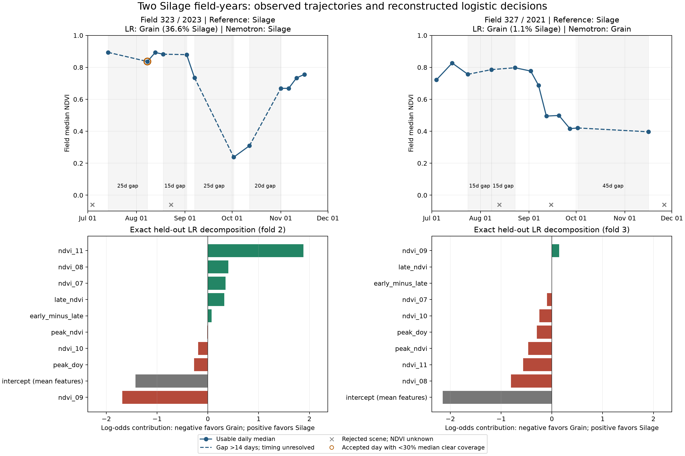

# Field 323 / 2023 versus field 327 / 2021

Both reference labels are **Silage**. These are different fields and years,
with different held-out training folds. This is an investigation of previously
scored examples, not a new validation experiment or a model improvement.

| Case | Logistic Silage probability | Logistic prediction | Nemotron prediction |
| --- | ---: | --- | --- |
| Field 323 / 2023 | 36.58% | Grain (wrong) | Silage (correct) |
| Field 327 / 2021 | 1.12% | Grain (wrong) | Grain (wrong) |

## Field 323: a decline falls inside an observation gap

The daily median NDVI is approximately **0.880 on September 2**, **0.735 on
September 7**, and **0.238 on October 2**. It is approximately 0.669 on
November 1 and 0.756 on November 16. There is a substantial observed decline
followed by renewed greenness. Those measurements do not establish the actual
harvest date or the cause of renewed vegetation.

Only September 2 and 7 contribute to the September monthly feature. Its value,
**0.807**, therefore represents early September rather than a well-observed
whole month. A **25-day gap** separates September 7 and October 2, leaving the
decline's timing unresolved. There are no accepted observations for the rest of
September. The model cannot see the dates within a month because it receives
monthly medians rather than the full trajectory.

The reconstructed fold-2 logistic model gives September NDVI a **-1.683**
log-odds contribution toward Silage (favoring Grain), the largest negative
feature contribution. November NDVI contributes **+1.885** (favoring Silage).
Other features and the intercept combine to produce 36.58%, below the 50%
decision threshold. Thus the actual fitted model weighs conflicting signals;
we are not merely guessing from a comparison with class averages.

July has only one usable date; September and October have two each. September
7 uses partially clear field coverage. August 8 has about 22% median clear
coverage, just above the extraction's 20% acceptance threshold. These are
coverage limitations, not download errors.

## Field 327: an earlier observed decline, sparse late season

NDVI is approximately **0.777 on September 2**, **0.495 on September 12**, and
**0.416 on September 27**. The trajectory does contain an early decline;
it would be incorrect to explain this miss as simply "no vegetation decline."

The last two usable dates are October 2 (0.421) and November 16 (0.397),
separated by **45 days**. There is only one usable October date and one usable
November date. We cannot establish what happened between those observations.

Its largest negative feature contributions are **August NDVI (-0.804)**,
**November NDVI (-0.568)**, and **peak NDVI (-0.466)**. September NDVI actually
contributes slightly toward Silage (+0.144). Combined with the remaining
features and the intercept, the logistic Silage probability is 1.12%.
The model is therefore relying on more than decline timing, including summer
greenness and November vegetation. Those relationships can reflect other
management or environmental differences; their physical causes are unverified.

## What the comparison establishes

Both cases have **12 usable dates**, zero read errors, and no missing final
features. Each has three rejected field-scene records. Field 323 has duplicate
processing entries that are collapsed to daily medians; field 327's accepted
records already have distinct dates. Equal observation totals conceal very
different within-month coverage and gaps. A filled feature table is not proof
of complete seasonal observation coverage.

For both cases, all probabilities in the reconstructed held-out fold match the
saved baseline within 1e-10. Training excludes every year of the target field.
Intercept plus standardized-feature contributions reproduces the decision
logit within 1e-12. Nemotron's target feature inputs match the same raw features.
Input hashes and these checks are recorded in `summary.json`.

Contributions are additive **log-odds**, not percentage-point changes or causal
effects. They are relative to the fitted fold's training means; the intercept
is the score at those mean feature values, not the observed class prevalence.
Monthly features are correlated, so their coefficients should not be read as
independent agricultural rules. The folds fit different models.

Nemotron returned only a class label for each case. Its saved response cannot
establish which features it relied on, or why its field-323 answer was correct.
No additional model explanations were requested after seeing the labels.

## Next checks

Inspect cloud-masked satellite imagery before and after each observed decline,
the field boundary, and the source label/harvest-date evidence. In particular,
check the September 7–October 2 gap for field 323 and late-season coverage for
field 327. Correct labels only with independent evidence, not model disagreement.

A future, prespecified feature experiment could retain decline timing,
observation gaps, and per-month coverage. These two cases suggest that question;
they do not prove that such features improve held-out performance. Keep these
baseline results and the frozen Nemotron prompt as comparison points, and use
independent new labels for a stronger final test.

## Reproduce offline

Use the analysis environment and install `baseline/requirements-diagnostics.txt`,
then run `python baseline/inspect_field_cases.py` from the project root. On this
machine: `baseline/.runtime/python.exe baseline/inspect_field_cases.py`.
No satellite downloads or model API calls are made. Original inputs, baseline
predictions, and Nemotron responses are read-only. `comparison.png`/`.svg`,
`feature_contributions.csv`, `daily_observations.csv`, and `summary.json` are
saved in this directory; this narrative is a separate interpretation.
